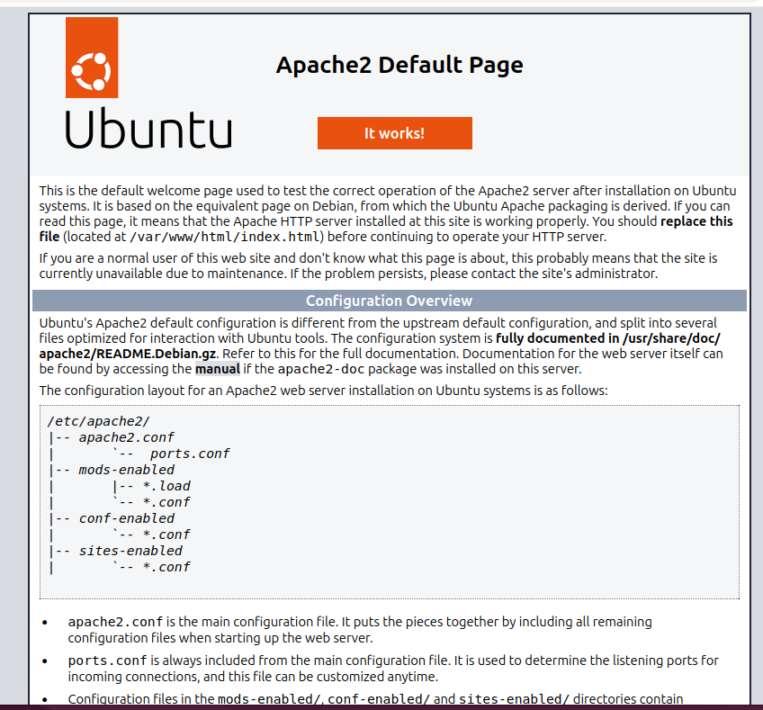

# Wazuh Shellshock Attack Detection

A hands-on SOC lab demonstrating how Wazuh SIEM detects a Shellshock-pattern HTTP request through Apache access-log monitoring and generates a high-severity security alert.

## 1. Project Overview

The objective was to validate Wazuh's ability to identify a suspicious HTTP request containing a Shellshock-style payload and generate an alert for investigation.

The test was performed in a controlled lab environment using Kali Linux, Ubuntu with Apache, and a Wazuh manager.

## 2. Lab Environment

| Component | Role | IP Address |
|---|---|---|
| Kali Linux | Attacker / test source | `192.168.1.104` |
| Ubuntu Linux | Apache web server and Wazuh agent | `192.168.1.103` |
| Wazuh Manager | Centralized monitoring and alerting | `192.168.1.102` |

### Apache Web Server

The Ubuntu Apache default page was accessible before the test, confirming that the web server was running.



*Figure 1: Apache web server running on the Ubuntu endpoint.*

### Wazuh Agent Readiness

Before sending the test request, the Wazuh agent was restarted and its service status was checked. The service returned `active`.


*Figure 2: Wazuh agent confirmed active before the test.*

## 3. Attack Simulation

A crafted HTTP request was sent from Kali Linux to the Ubuntu Apache server using a Shellshock-style string in the `User-Agent` header.

```bash
sudo curl -H "User-Agent: () { :; }; /bin/cat /etc/passwd" http://192.168.1.103
```


*Figure 3: Test request issued from the Kali Linux terminal.*

## 4. Apache Log Verification

The Ubuntu Apache access log recorded the request from `192.168.1.104`. The logged request contained the suspicious `User-Agent` value and returned HTTP status `200`.


*Figure 4: Apache access-log entry containing the Shellshock-pattern request.*

## 5. Wazuh Detection

Wazuh generated an alert matching the suspicious request recorded in the Apache access log.


*Figure 5: Wazuh alert list showing the Shellshock detection event.*

### Alert Details

| Field | Value |
|---|---|
| Alert description | Shellshock attack detected |
| Rule ID | `31168` |
| Severity | Level `15` |
| Rule groups | `web`, `accesslog`, `attack` |
| Source IP | `192.168.1.104` |
| Destination / agent IP | `192.168.1.103` |
| Agent name / ID | `ubuntu` / `001` |
| HTTP method and path | `GET /` |
| HTTP response | `200` |
| Apache log source | `/var/log/apache2/access.log` |
| Wazuh alert timestamp | October 24, 2026, 20:27:59.667 |

The rule metadata confirms the alert's ID, severity, and associated groups.


*Figure 6: Rule 31168, Level 15, and associated alert groups.*

### Alert Investigation

The event details identify the source IP, Ubuntu agent, request path, log location, and matched request content.


*Figure 7: Wazuh event fields used to investigate the suspicious request.*

Additional event fields show the alert timestamp, MITRE ATT&CK identifiers, and associated tactics and techniques.


*Figure 8: Additional alert metadata from the Wazuh event.*

### MITRE ATT&CK Mapping

The alert displayed the following MITRE ATT&CK identifiers:

- **T1068 — Exploitation for Privilege Escalation**
- **T1190 — Exploit Public-Facing Application**


*Figure 9: T1068 — Exploitation for Privilege Escalation.*


*Figure 10: T1190 — Exploit Public-Facing Application.*

These are the mappings shown in the Wazuh alert. Their presence does not independently prove that either technique was successfully executed.

## 6. Analysis and Findings

The test demonstrated successful **log-based detection**:

1. Apache recorded the suspicious HTTP request.
2. Wazuh processed the access-log event.
3. Rule `31168` generated a Level `15` alert.
4. The alert provided event fields that supported investigation of the request.

### Important Limitation

An HTTP `200` response means that the server returned a successful HTTP response. It does **not** prove that the injected `/bin/cat /etc/passwd` command executed or that the server was successfully exploited.

Confirming command execution would require additional endpoint evidence, such as process-execution audit logs correlated with the request timestamp.

## 7. Conclusion

The Shellshock detection test was successful from a monitoring perspective. Wazuh identified the suspicious request in the Apache access log and generated a high-severity alert with relevant event details.

This lab demonstrates practical experience with SIEM alert investigation, Linux endpoint monitoring, Apache log analysis, and MITRE ATT&CK context.

## 8. Reference

[Wazuh Documentation — Detecting a Shellshock Web Attack](https://documentation.wazuh.com/current/proof-of-concept-guide/detect-web-attack-shellshock.html)
